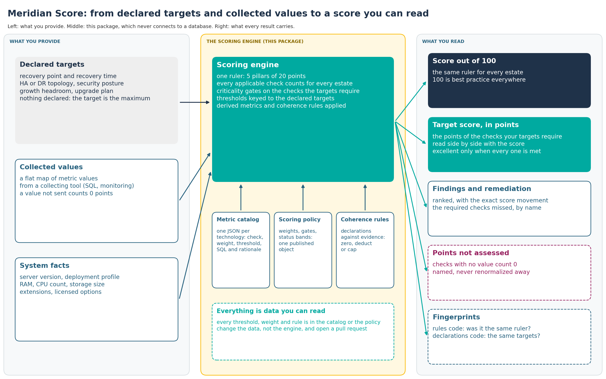

# Meridian Score

**Turn raw database metrics into a 0 to 100 health score with prioritized findings, and read every point of it.** PostgreSQL, Oracle, MySQL, MariaDB, MongoDB and SQL Server.

DBAs already collect dozens of metrics from `pg_stat_*`, `V$` views, `SHOW STATUS`, monitoring agents and ad-hoc scripts. The hard part is deciding which ones matter, how badly, and what to do about them. This package (`@dbi-services/scoring-core`) is the judgment layer behind the **Meridian score**: feed in a flat map of metric values, get back a structured score, a per-pillar breakdown, ranked findings and remediation actions. Every threshold, weight and rule lives in a reviewable JSON catalog, and every metric can carry the SQL that measures it and the reason its bound is what it is.

- **Apache 2.0 licensed**, zero runtime dependencies, pure scoring math.
- **Catalog-driven**: what is checked and how much it weighs is data, not code.
- **Readable without JavaScript**: the shared scoring rules are one published policy object; the simulator explains each metric in three questions.

**Status: beta.** The foundations (one ruler, a target per estate, gates, coherence rules, fingerprints) are settled; edge rules are tuned from real-world use and feedback, so a release may ship with a known, documented edge behaviour instead of waiting for it.

## Where the logic lives

| Question | Where the answer is | Read it as |
|---|---|---|
| What is checked, and how much does it weigh? | `data/metrics/<technology>.json`: one object per metric (criticality, pass criterion, description, remediation) plus the cross-metric consistency rules | JSON, see [docs/reading-a-catalog.md](docs/reading-a-catalog.md) |
| How is the value measured? | the metric's `technical_anchor` (the literal SQL or command) | the "How it is measured" section of the simulator's metric card, or the Anchor SQL column of the [scoring-spec workbooks](docs/scoring-spec/) |
| Why this threshold? | the metric's `rationale` | the "How it scores" section of the metric card |
| What are the shared rules (weights, gates, partial credit, status bands)? | `src/scoring/policy.js`, one frozen object the engine reads | the generated "Scoring policy" block in [docs/scoring-model.md](docs/scoring-model.md), or the simulator page "How the score works" |
| Who collects the values? | a collecting tool, separate from this package; this package never connects to a database | `docs/consumer-contract.md` states the input contract per metric |

## Five minutes with the simulator

```bash
git clone https://github.com/boutaga/Meridian-Score.git
cd Meridian-Score
npm run simulator:docker        # or: npm install && cd simulator && npm install && npm start
# open http://localhost:3000
```

The simulator has no authentication, so it listens on this machine only (127.0.0.1); the Docker compose file publishes the port the same way. Set `SIMULATOR_HOST` to change that, and read [SECURITY.md](SECURITY.md) first.

1. **How the score works**: the weights, the gates, the status bands and the point budget of the selected catalog, rendered from the policy object.
2. **Metrics**: search the catalog; open a metric to read what is checked, the SQL that measures it, and what a failure costs (its share of the points, the gate it trips, the rules that reference it).
3. **Simulator**: load a sample estate (healthy, uneven, average, almost-there), change values, watch the score, the findings and the maturity ladder move; paste a real collector payload, check its shape, score it.
4. **Score Map**: drill from pillars to subcategories to the metrics and the rules that link them.
5. **Impact Analyzer**: change a criticality, a flat threshold or a point budget, compare, export the modified catalog as JSON to open a pull request.

## What the score is

Monitoring tools answer *what is*: hundreds of metrics only experts can fully read. Meridian answers a different question: **is what is observed coherent with what you declared you need?**

You declare operational targets, an RPO, an RTO, a security posture, a growth headroom, an HA topology. The engine links each declaration to the configuration and runtime state that must back it and scores the incoherence between the two. A declaration is never graded (declaring a modest target costs nothing); a declaration contradicted by the evidence is invalidated by a consistency rule, and the subcategory it lives in is capped. Technological debt, in this model, is accumulated incoherence.

A concrete example: you declare an RTO of 15 minutes on a standalone PostgreSQL instance holding a terabyte. Backups are fine, restores are tested, and still the restore-time estimate exceeds the declared RTO, so the rule `PG-CR-RTO-3` zeroes the declaration and caps Recovery Readiness. The remedies it names are an HA topology or a smaller instance. Size is never penalised by itself; a target the size makes unachievable is.



### Score and target

The score is one ruler: every applicable check counts for every estate, 100 means best practice everywhere, and each pillar stays 20 points. Declared targets never switch a check off. They set a **target score**, the points of the checks those targets require, and the two are read side by side, in points. An estate that declares nothing is required to meet every check, so its target is the maximum. Doing more than the targets require (point-in-time recovery on a DEV) raises the score; it never makes up for a required check that is missed.

The status follows the required checks: `excellent` only when every check the targets require is met; below that, the status bands apply to the share of the target reached, with `good` as the ceiling, and `requiredMissed` names what keeps the estate off target.

Missing evidence is a cost, not a gap to hide: a check that was not collected counts 0 points, stays in the target, and is reported in `pointsNotAssessed`. Nothing is renormalized away, so the score never claims more than was looked at.

The result is designed to be read at three levels: one trustworthy number and its trend for management; per-pillar breakdowns, ranked findings and remediation for operators; the full audit trail (per-metric scores, threshold derivations, rule firings and their exact score movements) for experts.

### How the scoring works

| Pillar | Points | Focus |
|--------|--------|-------|
| **Backup & Recovery** | 20 | Data protection, WAL or redo archiving, PITR, retention, recovery readiness |
| **Security** | 20 | Authentication, encryption, access control, audit |
| **Capacity** | 20 | Storage, connections, maintenance, planning |
| **Performance** | 20 | Caching, queries, locking, replication |
| **Future-Proofing** | 20 | Version currency, configuration, upgrade readiness |

Each pillar is made of subcategories, each subcategory of metrics evaluated against a boolean, an enum, a threshold or a range. The shared rules, in one sentence each (the exact numbers come from the policy object and are listed in [docs/scoring-model.md](docs/scoring-model.md)):

- **Weighted scoring**: critical metrics count 3x, important 2x, advisory 1x.
- **Criticality gates**: a failed critical check the declared targets require caps its subcategory at 60 percent; a hard-failed or missing one also caps its pillar at 60 percent, so a failing foundation shows on the pillar tile instead of being diluted. A critical check the targets do not require never caps, nor does one the run had no means to collect (agent-only in a standalone run); like every uncollected check, the latter counts 0 points and is reported as not assessed. The SSL checks are a floor: every target requires them.
- **Declaration-keyed thresholds**: backup age, replication lag, restore time and growth runway derive their bound from the declared target.
- **Workload-profile and size-relative thresholds**: OLTP, OLAP and mixed workloads resolve differently; sizing metrics scale with declared RAM, CPU and storage.
- **Derived metrics**: the engine computes synthetic metrics (memory pressure, restore time) from collected values before scoring; their expressions are published in the policy.
- **Cross-metric rules**: consistency relations across settings fire findings and can zero a declaration, deduct points or cap a subcategory, annotated as `score_movement` in the output.

## See it in action

```javascript
const { ScoringEngine } = require('@dbi-services/scoring-core');

const engine = new ScoringEngine('postgresql');

// A complete healthy PostgreSQL payload shipped in this repository (run this
// from the root of a clone), with five checks broken. Values the payload
// leaves out count as missing, so start from a full collection, not from a
// handful of keys.
const sample = require('./data/samples/postgresql-healthy.json');
const result = engine.calculate({
  ...sample.values,
  connection_usage_pct: 240,          // pool saturated, rejecting sessions
  autovacuum_health: 'off',           // autovacuum off
  table_bloat_avg_pct: 45,            // bloat building up
  xid_wraparound_pct: 150,            // approaching wraparound
  pg_stat_statements: false,          // no query telemetry
}, {
  workloadProfile: sample.workloadProfile,   // 'mixed'
  systemFacts: sample.systemFacts,           // RAM, CPU count, storage size
  mode: 'agent',                             // the agent collects every check
  availableSources: ['sql', 'manual', 'zabbix', 'worker'],
});
// A standalone run cannot collect the four agent-only checks: their points
// count as not assessed (result.pointsNotAssessed) and the score drops with them.

console.log(result.totalScore, result.status);   // 84 'good'
for (const pillar of Object.values(result.pillars)) {
  console.log(pillar.name, pillar.score, '/', pillar.maxScore, pillar.criticalGated ? '(critical gate)' : '');
}   // Capacity and Performance read 12 / 20 (critical gate), the other three 20 / 20
console.log(result.allFindings.filter(f => f.severity === 'critical').map(f => f.title));
// [ 'Connection Usage < 80%', 'Autovacuum Enabled', 'XID Wraparound Safe', 'pg_stat_statements Enabled' ]
```

Findings name the metric, the remediation and, for rules, the exact score movement. The aggregate may look acceptable while four critical findings a single number would have hidden are still listed: that is the point of the gates.

## Supported technologies

| Technology | Catalog version | Maturity | Tech version | Heritage |
|------------|-----------------|----------|--------------|----------|
| PostgreSQL | 1.14.0 | measurement-reviewed | 18 | Derived from field experience with an earlier internal tool; reweighting, cross-metric mechanisms, declared targets in every pillar, production-relevance corrections benchmarked against industry tools and CIS PostgreSQL 16, target-aware thresholds; reviewed by dbi's PostgreSQL Technology Leader (2026-09) |
| Oracle | 1.11.0 | measurement-reviewed | 23ai | PostgreSQL-parity maturity plus the license and pack model, multitenant and MAA coverage, CIS Oracle Benchmark thresholds judged against a 19c fleet floor; reviewed by dbi's Oracle Technology Leader (2026-08) |
| MySQL | 1.3.1 | draft | 8.4 | First cut distilled from technology best practices; workload-profile patches |
| MariaDB | 1.3.1 | draft | 11.4 | First cut distilled from technology best practices; workload-profile patches |
| MongoDB | 1.2.1 | draft | 8 | First cut distilled from technology best practices |
| SQL Server | 1.2.1 | draft | 2022 | First cut distilled from technology best practices |

Maturity is stated in each catalog (`maturity`) and shown next to the catalog version in the simulator: `draft` (not yet reviewed by a technology leader), `measurement-reviewed` (how values are collected was reviewed; scoring validation pending), `field-evaluated` (scoring checked against real estates), `stable` (reviewed evidence for every scored judgment). Listing six engines does not mean the six are equally validated.

Metric counts and every metric's definition are in [docs/technologies/](docs/technologies/), regenerated from the catalogs.

## Validation status

All six catalogs are structurally sound: same engine, same schema, same algorithm, and the full test suite passes against the scoring math and the catalog content locks. The Oracle and PostgreSQL catalogs have each received a first review by the corresponding dbi Technology Leader (2026-08 and 2026-09); both reviews concentrated on how the values are collected, and their corrections are in the catalogs (`rationale` fields) and in the collector contract. The scoring-side validation (weights, gates, thresholds against real estates) is the next round; the other four catalogs await theirs. See [Validating a catalog](docs/guides/tl-validation-assignment.md).

Catalog changes that pass review ship as a new catalog version; the engine stays stable.

## Installation

```bash
npm install github:boutaga/Meridian-Score
```

The package is not on the npm registry yet; it installs from git under the name `@dbi-services/scoring-core`.

## Usage

```javascript
const { ScoringEngine, SCORING_POLICY } = require('@dbi-services/scoring-core');

const engine = new ScoringEngine('postgresql');
const result = engine.calculate(values, {
  mode: 'agent',                          // 'standalone' or 'agent'
  pgVersion: 170000,                      // filter version-gated metrics
  deploymentProfile: 'self-managed',      // filter profile-specific metrics
  installedExtensions: ['vector', 'pg_partman'],
  availableSources: ['sql', 'manual', 'zabbix'],
  workloadProfile: 'mixed',               // 'oltp' | 'olap' | 'mixed'
  licensedOptions: [],                    // Oracle packs and options the estate owns
  systemFacts: { ram_kb: 16777216, cpu_count: 8, storage_size_kb: 209715200 },
});

result.totalScore;        // 0 to 100, two decimals: every check counts for every estate
result.targetScore;       // the points of the checks the declared targets require
result.status;            // 'excellent' only when every required check is met, else from required points / target
result.requiredMissed;    // the required checks missed: flag "target not reached" with it
result.pointsNotAssessed; // points of applicable checks with no value (1.17.0): score + this never exceeds the maximum
result.pillars;           // per pillar: score, maxScore, target, targetAttainment, status, criticalGated
result.subcategories;     // per subcategory: the post-gate score
result.allFindings;       // [{ severity, title, remediation, rule_id?, score_movement? }]
result.recommendations;   // prioritized actions
result.coverage;          // how much of the applicable catalog was assessed
result.context.fingerprint; // rules code (same ruler?) and declarations code (same targets?)
SCORING_POLICY.statusBands; // { excellent: 90, good: 70, needs_improvement: 50 }
```

Load a catalog from an external source instead of the bundled JSON:

```javascript
const { MetricCatalog } = require('@dbi-services/scoring-core');
const catalog = MetricCatalog.fromData('postgresql', await fetchCatalogFromDB());
```

Export the rules as a bundle another organization can score against, and check one you received (from a clone, or with the installed `scoring-rules-bundle` command):

```bash
node scripts/rules-bundle.js export postgresql --declarations our-targets.json > bundle.json
node scripts/rules-bundle.js verify bundle.json
node scripts/rules-bundle.js score bundle.json my-payload.json
```

Check a real collector payload against the catalog before scoring it:

```bash
node scripts/check-payload.js postgresql my-payload.json
# reports: not provided, not applicable, unparseable, enum mismatch, unit suspect, unknown keys
```

## Documentation

- [Reading a catalog](docs/reading-a-catalog.md): one metric walked field by field, the policy in one page, how to read a rule.
- [Scoring model](docs/scoring-model.md): the algorithm, with the generated scoring policy block.
- [Consumer contract](docs/consumer-contract.md): the input and output contract for collecting tools, release by release.
- [Per-technology references](docs/technologies/): every metric of every catalog, regenerated.
- [Scoring-spec workbooks](docs/scoring-spec/): one Excel workbook per technology with the anchor SQL and the rationale per metric.
- [Contributing](CONTRIBUTING.md), [Adding a metric](docs/guides/adding-a-metric.md), [Technical anchors and rationale](docs/guides/metric-technical-anchor.md), [Authoring cross-metric rules](docs/guides/cross-metric-rules.md), [Reviewing weights](docs/guides/reviewing-weights.md), [Metric placement review](docs/guides/metric-placement-review.md), [Validating a catalog](docs/guides/tl-validation-assignment.md), [Reading the Score Map](docs/guides/score-map.md).

## Scripts

```bash
npm test                       # the full suite (scoring math + catalog content locks)
npm run validate-catalogs      # structural integrity and vocabularies of all catalogs
npm run generate-docs          # per-technology references + the scoring policy block
npm run generate-scoring-spec  # the Excel workbooks, from this repository alone
npm run check-payload -- <technology> <payload.json>   # shape report of a real collection
npm run extract-anchors -- --tech postgresql --out anchors.json   # maintainers: reads the collector's source
npm run benchmark -- <technology> <modified-catalog.json>          # score deltas on the samples
npm run simulator                # local Node
npm run simulator:docker         # Docker
```

## What it aims to become

Meridian is opened to the community with a normative ambition: a shared, understandable standard for database health, usable across technologies and environments by people at any level of expertise. The norm meets an estate where it is: raising your own targets reopens gaps, closing them raises your maturity. Best-practice baselines (CIS references) inform the default targets; they are not the norm. Every metric, threshold, weight and rule is a data artifact the community can read, challenge and evolve without touching the engine.

## License

Apache License 2.0, Copyright (c) 2026 dbi services. See [LICENSE](LICENSE).
